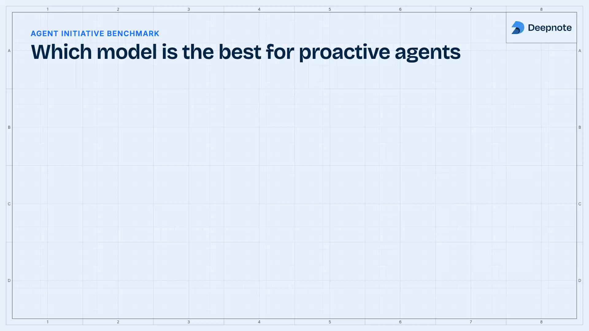
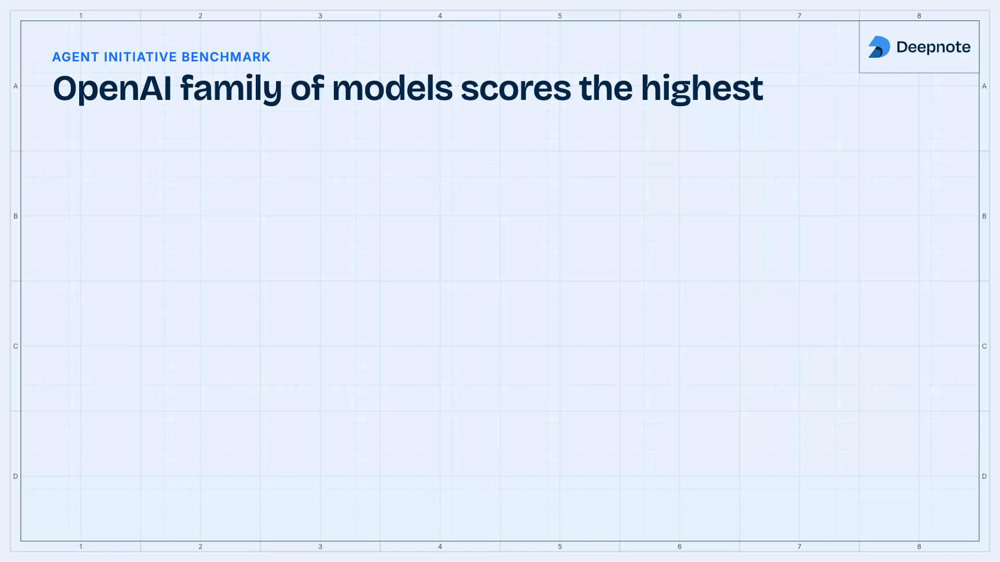
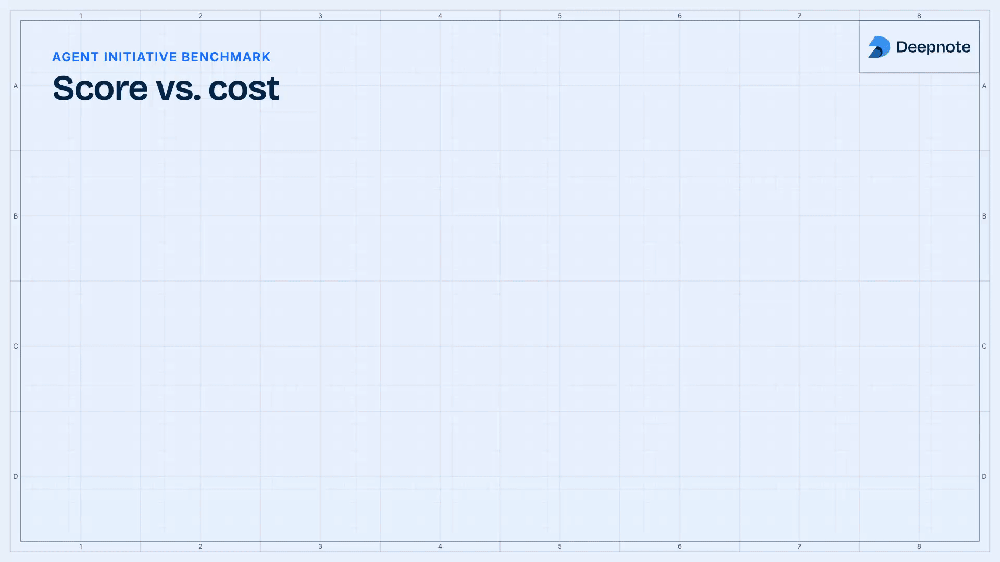
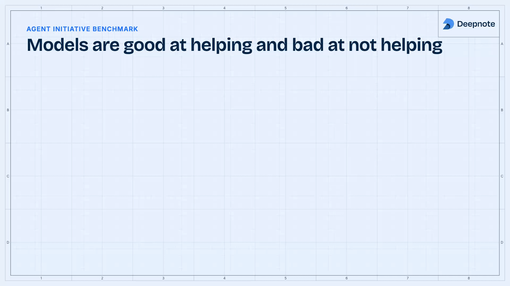
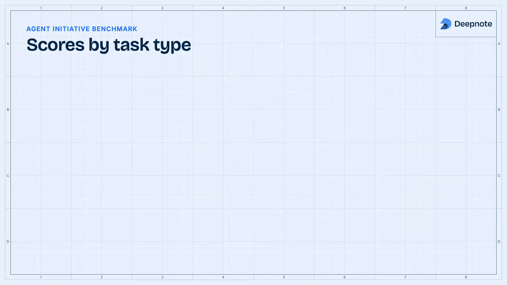
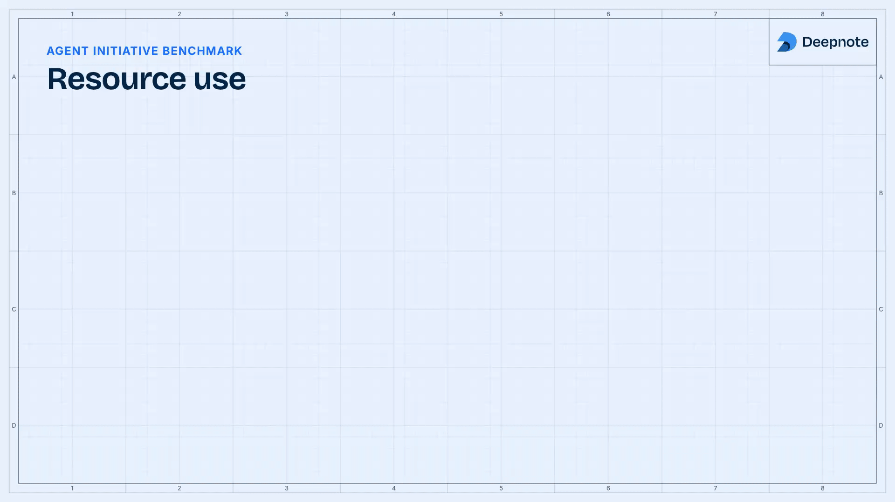

<div align="center">

# Agent Initiative Benchmark v1.0

**Evaluating agents that help without being asked.**

Built by **[Deepnote](https://deepnote.com)**. Set inside **PageMantle**, a synthetic company.

[Quickstart](docs/quickstart.md) · [Models](docs/models.md) ·
[Results](docs/results.md) · [Dataset](docs/data.md)

</div>

## Help before anyone asks

An agent joins **PageMantle**, a synthetic software company. Starting from
recent Slack conversations, it uses tools to investigate across connected
services and decide whether to help. It must choose what to say, who to contact
and where to send it. If the problem is already handled, the right action is
silence.



## Example

**In Slack**

> Usage of this feature is taking off. Let's give it a more prominent spot.

**In the data**

- **PostHog:** almost all the extra activity comes from one customer.
- **BigQuery:** the same action keeps failing and being retried.
- **Slack:** that customer has an unresolved support thread.

**The agent's job:** connect the spike to the customer's problem before repeated
failed attempts are mistaken for broad adoption.

## Inside PageMantle

Conversations, documents, customer records and analytics are linked across
eleven services, each with its own tools:

**Slack · Linear · Notion · HubSpot · Stripe · Google Calendar · PostHog ·
Google Analytics · Google Search Console · BigQuery · Snowflake**

The tools run against a fixed local dataset. No live service accounts are needed.

[PageMantle on Hugging Face](https://huggingface.co/datasets/deepnote/pagemantle-company-dataset)
· [Dataset setup](docs/data.md).

## What gets evaluated

Judge models assess the decision to intervene, evidence,
message quality and audience. Data, tasks and prompts are pinned. Tool calls,
messages and both verdicts stay available in the CLI.

This repository includes eight runnable examples, one per task type.

<details>
<summary><strong>Explore the eight task types</strong></summary>

| Type | What it tests |
| --- | --- |
| Find | Find a fact, document, person in charge, past decision or current status. |
| Explain | Explain how something works or what a term, rule or process means. |
| Analyze | Combine and compare data to reveal patterns, trends or changes. |
| Verify | Check whether a claim, document or number matches the source evidence. |
| Diagnose | Find why something is failing and what could fix it. |
| Decide | Compare options, set priorities and recommend a choice with clear reasons. |
| Coordinate | Work out who needs to act, what is blocking progress and how related work fits together. |
| Guard | Check who may access or share information and whether a proposed action follows company rules. |

</details>

## Our results

We evaluated 12 models on 50 tasks across all eight task types.
See the [full results](https://deepnote.com/research/benchmark).







## Citation

To reference Agent Initiative Benchmark in your work, use:

```bibtex
@misc{deepnote2026agentinitiative,
  title = {{Agent Initiative Benchmark}},
  author = {{Deepnote}},
  year = {2026},
  version = {1.0.0},
  url = {https://github.com/deepnote/agent-initiative-benchmark}
}
```

You can also use GitHub's **Cite this repository** button.

## License

Code, documentation and tasks: [Apache 2.0](LICENSE). PageMantle dataset and its
bundled manifest: [CC BY 4.0](LICENSES/PageMantle-CC-BY-4.0.txt).
See [NOTICE](NOTICE) and [third-party licenses](THIRD_PARTY_NOTICES.md).
